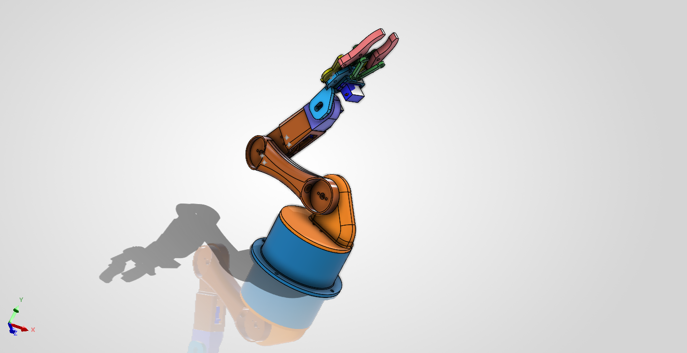
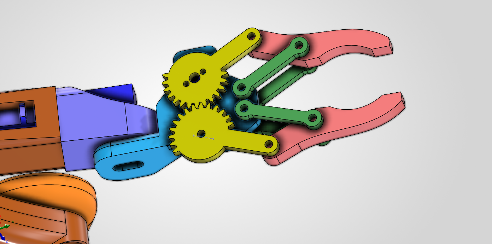

# 6-DOF Robotic Arm

A personal robotics engineering project focused on mechanical design, servo-based actuation, and robotic arm control.

## Overview

This project involves the design and development of a 6-degree-of-freedom robotic arm using CAD, SG90 and MG996R servo motors, and embedded control.

The objective is to develop a functional robotic arm capable of controlled joint movement and basic object manipulation while exploring mechanical design, electronics, and robotics software.

## Project Status

**Current stage:** Mechanical CAD development

The project is currently focused on the working on the math of forward and inverse kinematics and implementation in python. The Electronics integration, and physical assembly will be developed in subsequent stages.

## Objectives

- Develop a modular mechanical assembly.
- Design actuator mounting interfaces.
- Implement independent joint control.
- Develop forward kinematics.
- Explore inverse kinematics.
- Demonstrate basic object manipulation.

## Technologies

- CAD: SolidWorks
- Programming: Python / embedded C++ (planned)
- Actuation: Servo motors
- Electronics: To be determined

## Mechanical Design

The mechanical subsystem consists of a base, articulated links, joints, and an end effector(gripper).
## Full Assembly

### Gripper Assembly

## Development Roadmap

- [x] Begin mechanical CAD development
- [x] Complete mechanical assembly
- [x] Finalize actuator selection
- [ ] Develop electronics and power architecture
- [ ] Implement joint control
- [ ] Develop forward kinematics
- [ ] Develop inverse kinematics
- [ ] Test system integration
- [ ] Demonstrate object manipulation

## Results

Results, demonstrations, and test measurements will be added as the project progresses.

## Limitations

The project is under development. Performance specifications and final capabilities have not yet been validated.

## License

To be determined.
